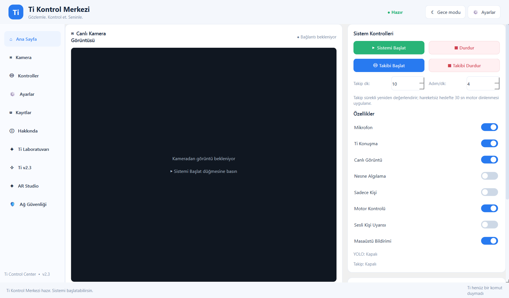
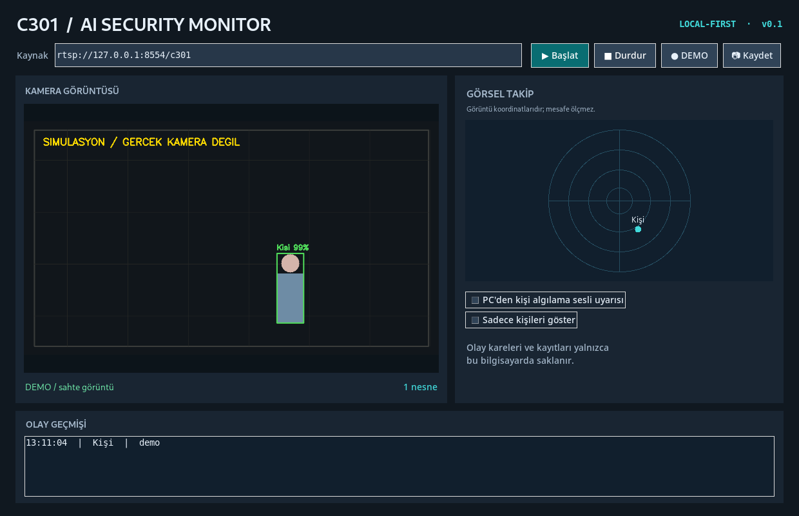

# C301 AI Security Monitor

> [!IMPORTANT]
> **Bu depo tamamlanmış bir ürün değil, geliştirilmeye devam edilen bir
> demo/prototiptir.** `v0.5.0-experimental`, bugüne kadar çalışan parçaları ve
> deneyleri güvenli bir başlangıç noktası olarak bir araya getirir. Kararlı sürüm
> hedefleri [yol haritasında](docs/ROADMAP.md) izlenir.

## Demo durumu: v0.5.0-experimental

Xiaomi Smart Camera C301 görüntüsünü Windows bilgisayarda yerel olarak işleyen;
YOLO ile nesne algılayan, olay kaydı tutan ve deneysel **Ti** sesli asistanını
çalıştıran bir prototiptir.

Güncel kod şunları içerir:

- C301/go2rtc yerel RTSP görüntüsü, Tkinter arayüzü ve YOLO11n nesne algılama.
- En-son-kare mimarisi, yerel JPEG/JSONL olay kaydı ve kişi mevcudiyeti kapısı.
- FFmpeg tabanlı düşük tamponlu görüntüleme ve gecikme teşhisi.
- Kamera mikrofonu → faster-whisper → Türkçe Ti komut motoru.
- Deneysel go2rtc ses geri kanalıyla C301 hoparlöründen yanıt verme.
- Opt-in tek kişi görsel merkezleme ve **varsayılan olarak kapalı**, fiziksel
  C301 üzerinde doğrulanmamış PTZ motor kodu.

Bu proje yüz tanıma yapmaz, kişilerin kimliğini belirlemez, fiziksel mesafe ölçen
bir radar değildir ve tek mikrofon akışından sesin yönünü tespit ettiğini iddia
etmez.

| Bileşen | Durum |
|---|---|
| Sentetik demo ve donanımsız testler | Doğrulandı |
| C301 → go2rtc → Python canlı görüntü | Kullanıcı tarafından görüldü |
| YOLO ve yerel olay kaydı | Kodlandı; gerçek ortam kalibrasyonu gerekli |
| Ti komut ayrıştırma | Kodlandı ve test edildi |
| Kamera mikrofonu/hoparlörü | Deneysel; yerel ses köprüsü gerekli |
| Görsel takip | Deneysel |
| PTZ motor hareketi | **Doğrulanmadı; varsayılan kapalı** |

### Mimari

```text
C301 ──► go2rtc ──► FFmpeg/OpenCV ──► YOLO ──► GUI + yerel olaylar
  │          │
  │          └── ses geri kanal ◄── gTTS ◄── Ti yanıtı
  └── mikrofon ──► PCM ──► Whisper ──► Ti komut motoru
```

### Güncel hızlı başlangıç

```powershell
py -3.11 -m venv .venv
.\.venv\Scripts\python.exe -m pip install --upgrade pip
.\.venv\Scripts\python.exe -m pip install -r requirements.txt
.\.venv\Scripts\python.exe main.py --demo
```

Yerel C301 akışı hazırsa:

```powershell
$env:OPENCV_FFMPEG_CAPTURE_OPTIONS = 'rtsp_transport;tcp'
.\.venv\Scripts\python.exe main.py --source 'rtsp://127.0.0.1:8554/c301_h264'
```

Ti için:

```powershell
.\.venv\Scripts\python.exe -m pip install -r requirements-voice.txt
.\.venv\Scripts\python.exe ti_assistant.py --mic-test 8
.\.venv\Scripts\python.exe ti_assistant.py --model small --threshold 220
```

İlk kez `Merhaba Ti` denir. Sonra `Ti, saat kaç?`, `Ti, nasılsın?` ve
`Ti, sistem durumu ne?` gibi komutlar kullanılabilir. `--enable-motor` normal
kullanım için önerilmez; stok go2rtc'de bulunmayan deneysel bir yerel uç noktaya
bağlıdır.

### Bundan sonra nasıl geliştirilecek?

1. Görüntü, yeniden bağlanma ve olay hattı gerçek C301 üzerinde uzun süreli
   ölçümlerle kararlı hale getirilecek.
2. Kamera, Ti ve olay ayarları tek güvenli yapılandırmada birleştirilecek.
3. Yerel Türkçe ses ve GUI entegrasyonu geliştirilecek.
4. PTZ yalnız donanım üzerinde güvenli sınırlar ve acil durdurma doğrulandıktan
   sonra normal kullanıma aday olacak.
5. Temiz Windows kurulumu, paketleme ve veri saklama politikası tamamlanmadan
   `v1.0` ilan edilmeyecek.

### Baştan bugüne ne yaptık?

İlk dört etiket 26 Ekim 2026 tarihli yerel ZIP paketlerinden yeniden oluşturuldu:

- `v0.1.0`: ilk GUI, YOLO, 2B görünüm ve yerel olay kayıtları.
- `v0.1.1`: yakalama ve çıkarımı ayıran en-son-kare mimarisi.
- `v0.1.2`: `--preview-only` gecikme izolasyonu.
- `v0.2.0-preview`: Türkçe ses/hava yardımcısı.
- `v0.5.0-experimental`: kamera sesi, Ti oturumu, kişi takibi ve kapalı
  varsayılan deneysel PTZ kodunun konsolidasyonu.

Tüm adımlar: [Geliştirme geçmişi](docs/HISTORY_TR.md) ·
[Mimari](docs/ARCHITECTURE.md) · [Yol haritası](docs/ROADMAP.md) ·
[Güvenlik](docs/SECURITY.md) · [Kaynak bütünlüğü](docs/INVENTORY_AUDIT.md) ·
[Arındırılmış Ti AI devam notları](docs/TI_AI_PROJECT_CONTINUATION_2026-10-31.md) ·
[Ti AI v2.3 çalıştırılabilir demo](ti_ai/README.md)

### Ti AI v2.3 arayüzü

Güncel, kişisel veriden arındırılmış PySide6 kaynakları `ti_ai/` klasöründedir.
Kamera ve hesap gerekmeden açılan gerçek arayüzün demo görüntüsü:



Gerçek `go2rtc.yaml`, Xiaomi hesabı/token'ı, cihaz kimliği, LAN bilgileri,
kamera görüntüleri, ses kayıtları, model ağırlıkları ve binary dosyalar bu depoya
konmaz. gTTS kullanıldığında söylenecek metin dış TTS hizmetine gider.

---

## Arşivden gelen v0.2.0 öncesi ayrıntılı notlar

**A Windows-first, local-first computer vision companion for Xiaomi Smart Camera C301.**

> **Status: v0.1.2 latency diagnostics experiment / early prototype.** The program and demo code are written;
> real C301 video is **reported working by the user** in go2rtc and the Python dashboard,
> but sustained playback, YOLO accuracy, and end-to-end latency are not yet validated.
> The project does **not** modify camera firmware, impersonate a true radar, or
> identify people by face.



**Xiaomi device discovery (26 Oct 2026):** Xiaomi Smart Camera C301 was visible in the go2rtc Xiaomi device loader using the **Singapore** region (Europe did not list it). Live-stream playback in go2rtc and Python was subsequently reported successful; long-term reliability is **not** verified. The actual `xiaomi://` source URL and account details must remain private. See [development journal](docs/DEVLOG.md).

**Windows 11 demo smoke test (26 Oct 2026):** user provided a screenshot
confirming the simulated dashboard runs. This is not a validated C301 video feed.
See [Windows demo screenshot](assets/windows-demo-2026-10-26.png) and
[development journal](docs/DEVLOG.md).


> **Current live-stream limitation (26 Oct 2026):** Although both go2rtc
> browser streams `c301` and `c301_h264` were observed working, Xiaomi CS2
> `pop buffer is full` warnings have since **recurred** using `subtype=sd`.
> The YAML quoting fix addressed stream parsing, not proven CS2 stability.
> See [Debug Investigation #006](docs/TROUBLESHOOTING_C301.md).

## v0.1.2: latency diagnostic mode

To compare latency **without YOLO**, run from the project's Python environment:

```powershell
$env:OPENCV_FFMPEG_CAPTURE_OPTIONS = 'rtsp_transport;tcp'
.\.venv\Scripts\python.exe main.py --source 'rtsp://127.0.0.1:8554/c301_h264' --preview-only
```

The live camera view runs, but object detection, alerting and automatic event
recording are disabled in this test. See [Latency diagnostic guide](docs/LATENCY_DIAGNOSTICS.md)
for a non-destructive GPU-accelerated alternative stream and comparisons.

## Features in this version

- Tkinter desktop dashboard (Windows; Python 3.11 or 3.12 recommended)
- go2rtc RTSP stream / USB webcam / video file input
- Ultralytics YOLO object detection, with configurable confidence
- Overlay boxes + camera-plane 2D dot plot (NOT distance radar)
- Detect class-level reappearance and save local JPEG + JSONL event records
- Manual snapshots; optional spoken PC-only person alerts
- Safe **DEMO** with simulated input without a Xiaomi account

## 1. Windows installation

Install Python 3.11/3.12, then from the project root in PowerShell:

```powershell
py -3.11 -m venv .venv
.\.venv\Scripts\python.exe -m pip install --upgrade pip
.\.venv\Scripts\python.exe -m pip install -r requirements.txt
```

`pip install` can take time because Ultralytics installs PyTorch. The
`yolo11n.pt` pretrained weights are fetched automatically by Ultralytics on the
first real camera connection, so internet access is needed once.

### Try the dashboard first (no camera required)

```powershell
.\.venv\Scripts\python.exe main.py --demo
```

This shows **synthetic demo imagery**, clearly marked; the fake person label
is not a successful AI inference result.

## 2. Connect the real Xiaomi Smart Camera C301

1. **Only use your own Xiaomi camera/account.** Put the C301 and PC on the same
   trusted Wi-Fi/network. Camera uses 2.4 GHz Wi-Fi.
2. Download official Windows 64-bit `go2rtc_win64.zip` from
   https://github.com/AlexxIT/go2rtc/releases (1.9.13+ for Xiaomi support;
   newer stable releases recommended).
3. Unzip `go2rtc.exe` into a **separate private directory**, for example
   `C:\camera-local\go2rtc\`. **Do not put the real YAML configuration under Git.**
4. Copy `config/go2rtc-local.example.yaml` there and rename to `go2rtc.yaml`.
5. In that directory, start `go2rtc.exe`, then open **http://127.0.0.1:1984/**.
6. In the go2rtc Web UI, select **Add → Xiaomi**. Sign in with your own Xiaomi
   Home credentials, complete any required verification, and add your C301.
   **Never share account passwords, 2FA codes, Xiaomi tokens, or real config.**
7. Go to the **Config** view. Ensure your C301 stream has the safe name `c301`:

   ```yaml
   streams:
     c301: "xiaomi://..."  # placeholder only; USE the URL generated by go2rtc
   ```

   This is illustrative; do not overwrite the Xiaomi token and device details
   auto-generated by go2rtc, and keep the `api` / `rtsp` loopback settings.
   Save and restart go2rtc. Confirm the stream exists and can be viewed.
8. Start the Python application:

   ```powershell
   .\.venv\Scripts\python.exe main.py --source rtsp://127.0.0.1:8554/c301
   ```

If OpenCV cannot read this stream, check the go2rtc **stream probe**, codecs,
Xiaomi model status, and FFmpeg installation. **Listing C301 as known does not
mean every firmware, region, codec, or account works.** No RTSP port needs to
be exposed on the camera itself; go2rtc creates the local RTSP bridge.

### C301 debugging notes

- The user reported an initial cessation of `cs2: pop buffer is full` warnings after switching the stream definition to a YAML list-item (`-`) and restoring a known-working backup. This is a **user-observed workaround**, not a demonstrated upstream fix.
- HEVC decoding warnings (`Could not find ref with POC 8` and `cu_qp_delta` outside range) remain under investigation.
- Details, sanitized sample, validation and rollback: **[C301 Debug Fix #001](docs/TROUBLESHOOTING_C301.md)**.

## 3. Other sources / settings

```powershell
# First USB webcam (works as input without Xiaomi)
.\.venv\Scripts\python.exe main.py --source 0

# Video file
.\.venv\Scripts\python.exe main.py --source "C:\Videos\sample.mp4"

# CPU; mute spoken PC alerts; show only people
.\.venv\Scripts\python.exe main.py --device cpu --mute --person-only
```

`--device cuda:0` requires **a CUDA-enabled PyTorch installation** compatible
with your Nvidia GPU; installing the basic requirements does NOT guarantee it.

## Data and privacy

- Camera **event images** and **timestamps** are written to `private_data/`,
  excluded from Git by `.gitignore`; the system does **not** upload any frames.
- A new event triggers on class reappearance with a gap + cooldown. It cannot
  distinguish one person from another, or reliably detect a doorway crossing.
- For **continuous 24/7 recording**, use a dedicated NVR; this prototype saves
  **events** rather than every video frame to prevent unbounded disk usage.
- The sample go2rtc config binds HTTP/RTSP to `127.0.0.1`. Do not forward ports
  `1984` / `8554` to the internet; credentials in actual YAML must remain private.
- Xiaomi encryption-key retrieval requires internet even when media goes locally.
- Audio warning plays on the **PC**, not directly on the C301 speaker.
- Only record where you have permission; get consent as appropriate, especially
  before sharing screenshots online.

## Documentation and tests

- `docs/DEVLOG.md` — development journal and progress evidence
- `docs/LATENCY_DIAGNOSTICS.md` — user-reported 3-second delay and controlled isolation tests
- `docs/TROUBLESHOOTING_C301.md` — CS2 workaround, HEVC decoder investigation and rollback
- `docs/ROADMAP.md` — implemented vs planned features
- `docs/LINKEDIN_DRAFT.md` — carefully worded LinkedIn draft for a future post
- `docs/GITHUB_RELEASE_CHECKLIST.md` — how to avoid accidentally sharing sensitive data
- `config/go2rtc-local.example.yaml` — security-minded starting configuration

Run unit tests (does not require camera or external AI weights):

```powershell
.\.venv\Scripts\python.exe -m unittest discover -s tests -v
```

## Known limitations

1. C301 video playback in go2rtc and the Windows Python app is user-reported working; sustained stability and YOLO inference results remain unverified; some Xiaomi account-region or firmware versions
   may fail, even when the model appears in the community list.
2. Inference is CPU-first; v0.1.1 decouples it from video capture, but heavy load or software transcoding can still cause lag.
3. Marker position uses only the detected object center in the camera image;
   it is neither a measured range nor a physically calibrated room map.
4. GUI doesn't persist custom settings yet and Windows speech voices may vary.
5. go2rtc's general two-way audio capability does **not** guarantee custom
   camera-speaker playback works on this camera.
6. This app incorporates third-party libraries (go2rtc, Ultralytics, etc.).
   For redistribution or commercial use, review their current license terms.

## References

- https://go2rtc.org/internal/xiaomi/
- https://go2rtc.org/internal/rtsp/
- https://go2rtc.org/internal/api/
- https://docs.ultralytics.com/modes/predict/
- https://github.com/AlexxIT/go2rtc/issues/1982

### Future development journal entries

Keep evidence of each coding session with:

```powershell
.\.venv\Scripts\python.exe scripts/new-devlog-entry.py
```

The helper appends a dated log to `docs/DEVLOG.md`. Commit the source and
non-sensitive journal entries to GitHub; **never commit the local camera data**.

### First GitHub push (after reviewing the privacy checklist)

```powershell
git init
git add .
git status --short
git commit -m "feat: bootstrap C301 AI monitor demo and event logging"
git branch -M main
# Create an EMPTY repository named C301-AI-Security-Monitor on GitHub first.
git remote add origin https://github.com/YOUR_USERNAME/C301-AI-Security-Monitor.git
git push -u origin main
```


### H.265/green-frame troubleshooting

If go2rtc web playback looks normal but the Python RTSP input is all green,
see [Debug Investigation #004](docs/TROUBLESHOOTING_C301.md#debug-investigation-004--correct-go2rtc-webui-video-all-green-opencv-video).
The guide describes an **optional** `c301_h264` FFmpeg sibling stream, preserving
the original `c301` source for rollback. This workaround has **not** yet been
validated on the user's camera.


### October 26, 2026 — live go2rtc status

Two browser streams `c301` and `c301_h264` have been **user-confirmed working**
after fixing quoted stream sources in the private go2rtc YAML. The Windows Python RTSP viewer is now confirmed by user report; real-world YOLO detection and end-to-end latency improvement still need testing. See [Debug Fix #005](docs/TROUBLESHOOTING_C301.md#debug-fix-005--verification-update-2026-10-26).


## v0.1.1 — Lower-latency RTSP preview (experimental)

**User confirmation:** The local C301 RTSP H.264 stream became visible in
AI Security Monitor on 26 Oct 2026, but there was significant display delay.
The previous version used a single loop for `cap.read()` and YOLO prediction.
This new version reads RTSP continuously on a dedicated thread, overwrites
stale frames with the latest one, and performs AI inference independently.
Tkinter renders only the latest queued preview frame per GUI tick, instead of
repainting every queued intermediate image.

Test on Windows (working `go2rtc.yaml` and Python `.venv` unchanged):

```powershell
$env:OPENCV_FFMPEG_CAPTURE_OPTIONS = 'rtsp_transport;tcp'
.\.venv\Scripts\python.exe main.py --source 'rtsp://127.0.0.1:8554/c301_h264' --imgsz 416
```

On slow CPUs, try `--imgsz 320 --inference-interval 0.7`. This trades some
object detection detail and responsiveness for less CPU time. If CUDA-enabled
PyTorch is installed, `--device 0` can be tested separately. Do **not** assume
CUDA support just because the PC has an Nvidia graphics chip.

**Limits:** This reduces app-induced queue delay; it does not guarantee a fixed
end-to-end delay if go2rtc/FFmpeg transcoding or the camera itself buffers
video. Bounding boxes may briefly trail the latest preview during inference.
Use a side-by-side clock/gesture comparison to measure actual latency.
The camera firmware and private go2rtc YAML are not changed.

To roll back, restore the previously working v0.1.0 project files; keep your
`.venv` directory. Never upload a real go2rtc YAML or tokens to GitHub.


## Optional: Turkish voice/weather companion (v0.2.0 preview)

Voice/weather is an independent **PC microphone and PC speaker** companion, not yet integrated as a dashboard button. No Xiaomi firmware changes. See [Voice Assistant Setup](docs/VOICE_ASSISTANT.md). Quick text-only test (in project folder, after voice dependencies are installed):

```powershell
.\.venv\Scripts\python.exe -m pip install -r requirements-voice.txt
.\.venv\Scripts\python.exe voice_assistant.py --text "Ankara hava nasıl?" --city Ankara --mute
```

To record a spoken question on demand: `voice_assistant.py --listen --city Ankara`. A full general chat assistant is **not yet implemented**.
