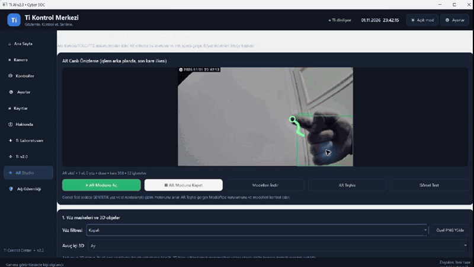
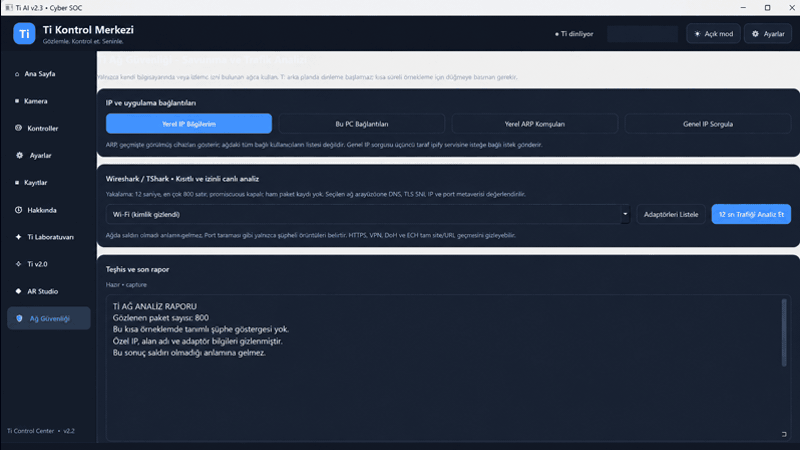

# C301 AI Security Monitor

<p align="center">
  <a href="README.md"></a>
  <a href="README_EN.md"></a>
  <a href="#c301-çekirdek-demosu--hızlı-başlangıç"></a>
  <a href="docs/ROADMAP.md"></a>
  <a href="docs/SECURITY.md"></a>
</p>

<p align="center">
  <a href="https://github.com/batuthzcode/C301-AI-Security-Monitor/actions/workflows/tests.yml"></a>
  
  
  
</p>

> [!IMPORTANT]
> **Bu depo tamamlanmış bir ürün değil, geliştirilmeye devam edilen bir
> demo/prototiptir.** C301 `v0.5.0-experimental` ve Ti AI `v2.3`, bugüne kadar
> çalışan parçaları güvenli bir başlangıç noktası olarak bir araya getirir. Kararlı sürüm
> hedefleri [yol haritasında](docs/ROADMAP.md) izlenir.


## Proje durumu: C301 v0.5.0-experimental + Ti AI v2.3 demo

Xiaomi Smart Camera C301 görüntüsünü Windows bilgisayarda yerel olarak işleyen;
YOLO ile nesne algılayan, olay kaydı tutan ve deneysel **Ti** sesli asistanını
çalıştıran bir prototiptir.

Güncel PySide6 kontrol merkezi, kurulum betiği ve kişisel veriden arındırılmış
kaynaklar: **[Ti AI v2.3 çalıştırılabilir demo](ti_ai/README.md)**.

## Ti'nin amacı: kameradan kişisel asistana

Ti'yi yalnızca nesne algılayan bir güvenlik kamerası olarak değil, bilgisayarımda
ve C301 kameramla birlikte çalışan deneysel bir **kişisel asistan** olarak
tasarlıyorum:

- Kamera durumunu, son olayları ve sistem sağlığını Türkçe sorularla öğrenmek.
- “**Ti, saldırı tehdidi var mı?**” dendiğinde son yerel Cyber SOC örneklemini
  özetlemek; görülen şüphe göstergelerini ve analizin sınırlarını sesli anlatmak.
- İsteğe bağlı yerel/Ollama veya OpenAI sohbeti yapılandırıldığında genel sorulara
  yanıt vermek ve günlük komutlarda yardımcı olmak.
- Sıkıldığımda AR Studio'da parmakla havaya çizmek, el hareketlerini ve görsel
  efektleri denemek.
- Nesne/kişi algılama ve yerel olay kaydıyla kamerayı daha anlaşılır bir güvenlik
  arayüzüne dönüştürmek.

Cyber SOC sonucu bir antivirüs veya profesyonel SOC kararı değildir. Kısa ve
izinli ağ örneklemini açıklar; “şüphe bulunmadı” sonucu saldırı olmadığını garanti
etmez.

Güncel kod şunları içerir:

- C301/go2rtc yerel RTSP görüntüsü, Tkinter arayüzü ve YOLO11n nesne algılama.
- En-son-kare mimarisi, yerel JPEG/JSONL olay kaydı ve kişi mevcudiyeti kapısı.
- FFmpeg tabanlı düşük tamponlu görüntüleme ve gecikme teşhisi.
- Kamera mikrofonu → faster-whisper → Türkçe Ti komut motoru.
- Deneysel go2rtc ses geri kanalıyla C301 hoparlöründen yanıt verme.
- Opt-in tek kişi görsel merkezleme ve **varsayılan olarak kapalı**, fiziksel
  C301 üzerinde doğrulanmamış PTZ motor kodu.

Bu proje yüz tanıma yapmaz, kişilerin kimliğini belirlemez, fiziksel mesafe ölçen
bir radar değildir ve tek mikrofon akışından sesin yönünü tespit ettiğini iddia
etmez.

| Bileşen | Durum |
|---|---|
| Sentetik demo ve donanımsız testler | Doğrulandı |
| C301 → go2rtc → Python canlı görüntü | Kullanıcı tarafından görüldü |
| YOLO ve yerel olay kaydı | Kodlandı; gerçek ortam kalibrasyonu gerekli |
| Ti komut ayrıştırma | Kodlandı ve test edildi |
| Kamera mikrofonu/hoparlörü | Deneysel; yerel ses köprüsü gerekli |
| Görsel takip | Deneysel |
| PTZ motor hareketi | **Doğrulanmadı; varsayılan kapalı** |

### Canlı özellik testleri

| AR Studio — gerçek parmak çizimi | Cyber SOC — anonimleştirilmiş gerçek test |
|---|---|
| [](ti_ai/assets/ti-ai-v2.3-ar-live-drawing.png) | [](ti_ai/assets/ti-ai-v2.3-cyber-soc-live-redacted.png) |

GIF'lere tıklayarak tam çözünürlüklü test karelerini açabilirsiniz.

AR karesi gerçek C301 görüntüsünde MediaPipe el takibiyle parmak çiziminin
çalıştığı anda alındı. Cyber SOC karesi ise izinli Wi-Fi adaptöründe yapılan
12 saniyelik, 800 paketle sınırlı gerçek testin yayın için anonimleştirilmiş
özetidir. IP, alan adı, adaptör kimliği ve kesin tarih/saat kaldırıldı.

### Mimari

```text
C301 ──► go2rtc ──► FFmpeg/OpenCV ──► YOLO ──► GUI + yerel olaylar
  │          │
  │          └── ses geri kanal ◄── gTTS ◄── Ti yanıtı
  └── mikrofon ──► PCM ──► Whisper ──► Ti komut motoru
```

### C301 çekirdek demosu — hızlı başlangıç

```powershell
py -3.11 -m venv .venv
.\.venv\Scripts\python.exe -m pip install --upgrade pip
.\.venv\Scripts\python.exe -m pip install -r requirements.txt
.\.venv\Scripts\python.exe main.py --demo
```

Yerel C301 akışı hazırsa:

```powershell
$env:OPENCV_FFMPEG_CAPTURE_OPTIONS = 'rtsp_transport;tcp'
.\.venv\Scripts\python.exe main.py --source 'rtsp://127.0.0.1:8554/c301_h264'
```

Ti için:

```powershell
.\.venv\Scripts\python.exe -m pip install -r requirements-voice.txt
.\.venv\Scripts\python.exe ti_assistant.py --mic-test 8
.\.venv\Scripts\python.exe ti_assistant.py --model small --threshold 220
```

İlk kez `Merhaba Ti` denir. Sonra `Ti, saat kaç?`, `Ti, nasılsın?` ve
`Ti, sistem durumu ne?` gibi komutlar kullanılabilir. `--enable-motor` normal
kullanım için önerilmez; stok go2rtc'de bulunmayan deneysel bir yerel uç noktaya
bağlıdır.

### Ti AI v2.3 — hızlı başlangıç

Windows 10/11 ve Python 3.11 üzerinde:

```powershell
cd ti_ai
.\Kurulum.cmd
.\Ti_Baslat.cmd
```

Kamera veya hesap olmadan gerçek arayüz açılır. C301 görüntüsü, motor ve hoparlör
özellikleri için kullanıcının kendi yerel go2rtc yapılandırması gerekir.

### Bundan sonra nasıl geliştirilecek?

1. Görüntü, yeniden bağlanma ve olay hattı gerçek C301 üzerinde uzun süreli
   ölçümlerle kararlı hale getirilecek.
2. Kamera, Ti ve olay ayarları tek güvenli yapılandırmada birleştirilecek.
3. Yerel Türkçe ses ve GUI entegrasyonu geliştirilecek.
4. PTZ yalnız donanım üzerinde güvenli sınırlar ve acil durdurma doğrulandıktan
   sonra normal kullanıma aday olacak.
5. Temiz Windows kurulumu, paketleme ve veri saklama politikası tamamlanmadan
   `v1.0` ilan edilmeyecek.

### Geliştirmeye açık alanlar

Bu depo bir son ürün değil; yeni modüller ve daha güvenli entegrasyonlar için
deney alanıdır. Planlanan veya katkıya açık başlıklar:

- **Daha güçlü kişisel asistan:** tamamen yerel LLM seçeneği, izinli ve silinebilir
  hafıza, daha doğal Türkçe konuşma ve bağlamlı takip soruları.
- **Daha iyi güvenlik özeti:** açıklanabilir kural motoru, zaman içindeki değişimi
  gösteren raporlar ve yalnız kullanıcının seçtiği bildirim kanalları.
- **Çoklu kamera:** birden fazla yerel akış, kamera bazlı bölgeler ve ortak olay
  zaman çizelgesi.
- **AR ve erişilebilirlik:** yeni el hareketleri, daha kararlı çizim, klavye/ses
  alternatifleri ve düşük donanım modu.
- **Güvenli otomasyon:** Home Assistant gibi servislerde açık izinler, işlem
  günlüğü, geri alma ve kritik eylemler için kullanıcı onayı.
- **Paketleme ve test:** imzalı Windows paketi, temiz kurulum testi, uzun süreli
  kamera dayanıklılık ölçümü ve farklı C301 yazılımlarında uyumluluk matrisi.

Yeni bir özellik önerirken gizlilik varsayılanı, yerel çalışma, açık kullanıcı
izni ve geri alınabilir eylemler korunmalıdır. Teknik hedefler ve mevcut sınırlar
[yol haritasında](docs/ROADMAP.md) tutulur.

### Baştan bugüne ne yaptık?

İlk dört etiket 26 Ekim 2026 tarihli yerel ZIP paketlerinden yeniden oluşturuldu:

- `v0.1.0`: ilk GUI, YOLO, 2B görünüm ve yerel olay kayıtları.
- `v0.1.1`: yakalama ve çıkarımı ayıran en-son-kare mimarisi.
- `v0.1.2`: `--preview-only` gecikme izolasyonu.
- `v0.2.0-preview`: Türkçe ses/hava yardımcısı.
- `v0.5.0-experimental`: kamera sesi, Ti oturumu, kişi takibi ve kapalı
  varsayılan deneysel PTZ kodunun konsolidasyonu.

Tüm adımlar: [Geliştirme geçmişi](docs/HISTORY_TR.md) ·
[Mimari](docs/ARCHITECTURE.md) · [Yol haritası](docs/ROADMAP.md) ·
[Güvenlik](docs/SECURITY.md) · [Kaynak bütünlüğü](docs/INVENTORY_AUDIT.md) ·
[Arındırılmış Ti AI devam notları](docs/TI_AI_PROJECT_CONTINUATION_2026-10-31.md) ·
[Ti AI v2.3 çalıştırılabilir demo](ti_ai/README.md)

Gerçek `go2rtc.yaml`, Xiaomi hesabı/token'ı, cihaz kimliği, LAN bilgileri,
kamera görüntüleri, ses kayıtları, model ağırlıkları ve binary dosyalar bu depoya
konmaz. gTTS kullanıldığında söylenecek metin dış TTS hizmetine gider.

## Lisans

Bu deponun özgün kaynak kodu [MIT Lisansı](LICENSE) ile sunulur. Kullanılan
üçüncü taraf kütüphane ve hizmetler kendi lisans ve kullanım koşullarına
tabidir.
