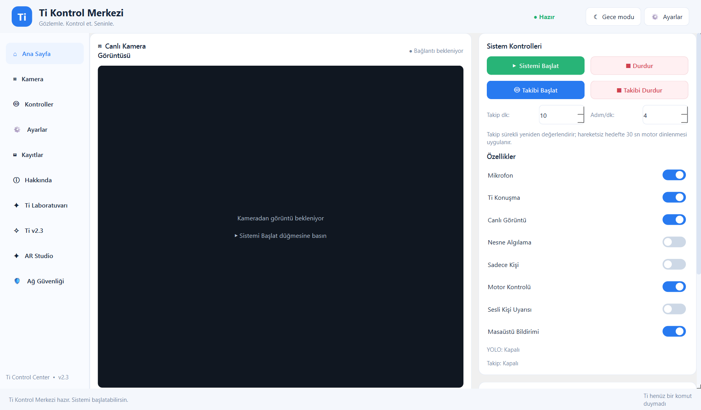
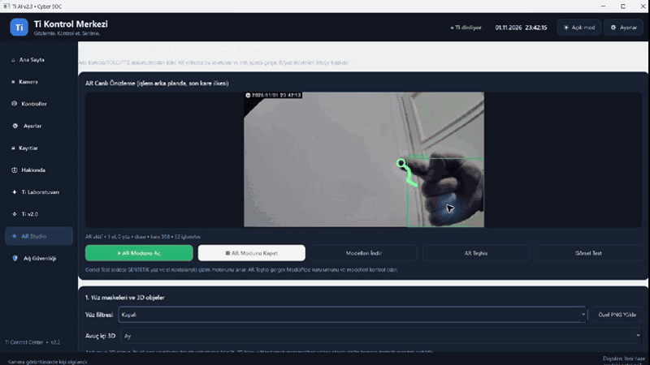
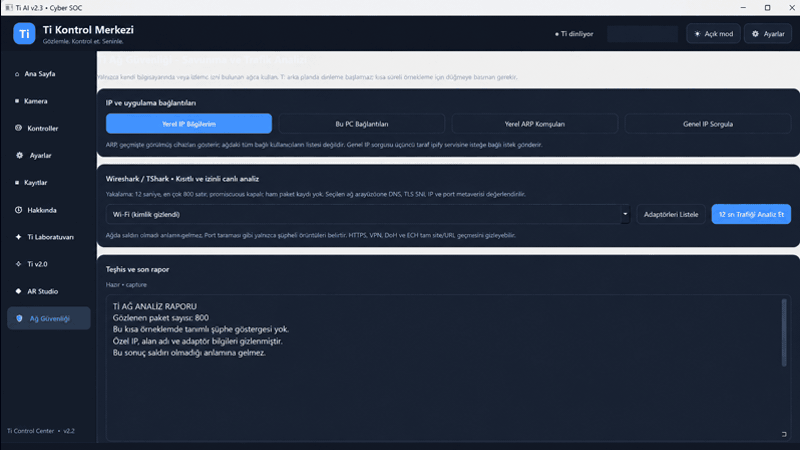

# C301 AI Security Monitor + Ti AI

<p align="center">
  <a href="README.md"></a>
  <a href="README_EN.md"></a>
  <a href="#quick-start"></a>
  <a href="docs/ROADMAP.md"></a>
  <a href="docs/SECURITY.md"></a>
</p>

<p align="center">
  <a href="https://github.com/batuthzcode/C301-AI-Security-Monitor/actions/workflows/tests.yml"></a>
  
  
  
</p>

> [!IMPORTANT]
> This repository is an evolving **demo/prototype**, not a finished security
> product. C301 `v0.5.0-experimental` and Ti AI `v2.3` bring the currently
> working parts together as a privacy-conscious development baseline.



## From a camera monitor to a personal assistant

Ti is an experimental personal assistant designed to work with a local Xiaomi
Smart Camera C301 stream and a Windows computer. The goal is to put camera
events, Turkish voice commands, system status, optional chat and small creative
tools in one control center.

You can use Ti to:

- ask about camera state, recent events and basic system health;
- ask “**Ti, is there an attack threat?**” and hear a plain-language summary of
  the latest local Cyber SOC sample, including its limitations;
- answer general questions when an optional local/Ollama or OpenAI chat model is
  configured;
- draw in the air with a finger and explore hand-driven effects in AR Studio;
- run local object/person detection and keep local event records.

The Cyber SOC view is not an antivirus verdict or a professional SOC. It
describes a short, authorized network sample. “No configured indicator was
triggered” never guarantees that no attack exists.

## Live feature tests

| AR Studio — live finger drawing | Cyber SOC — redacted live test |
|---|---|
| [](ti_ai/assets/ti-ai-v2.3-ar-live-drawing.png) | [](ti_ai/assets/ti-ai-v2.3-cyber-soc-live-redacted.png) |

Click either GIF to open the full-resolution test frame. The AR frame shows real
MediaPipe hand tracking over a C301 image. The Cyber SOC frame comes from a real
12-second, 800-packet authorized Wi-Fi sample; IP addresses, domains, adapter
identifiers and the exact timestamp were removed for publication. No raw packet
capture is stored.

## What is included?

- Local C301/go2rtc RTSP streaming and low-buffer FFmpeg/OpenCV capture.
- YOLO11n object/person detection with local JPEG/JSONL events.
- A PySide6 control center with dark/light themes.
- Faster-Whisper Turkish voice commands and an experimental camera-speaker path.
- Opt-in person centering, photo/video controls and local diagnostics.
- AR Studio with hand/face landmarks, air drawing, masks and simple 3D objects.
- Local network observation reports and manually imported router inventory
  comparison.
- Optional Ollama/OpenAI chat, Telegram, Home Assistant, Spotify and a local
  mobile panel.

The project does not identify faces, diagnose people, measure physical distance
or claim radar-like sensing. PTZ motor control and two-way audio remain
experimental and may not work with every C301 firmware version.

## Architecture

```text
C301 ──► go2rtc ──► FFmpeg/OpenCV ──► YOLO ──► UI + local events
  │          │
  │          └── speaker return ◄── TTS ◄── Ti response
  └── microphone ──► PCM ──► Whisper ──► Ti command engine
```

## Quick start

### Core C301 demo

```powershell
py -3.11 -m venv .venv
.\.venv\Scripts\python.exe -m pip install --upgrade pip
.\.venv\Scripts\python.exe -m pip install -r requirements.txt
.\.venv\Scripts\python.exe main.py --demo
```

### Ti AI v2.3 control center

On Windows 10/11 with Python 3.11:

```powershell
cd ti_ai
.\Kurulum.cmd
.\Ti_Baslat.cmd
```

The real UI can open without a camera or account. Real C301 video, motor and
speaker features require the user's own local go2rtc configuration. Never commit
real `go2rtc.yaml`, camera tokens, account credentials or LAN history.

## Designed to grow

This is a development platform rather than a closed product. Useful future work
includes:

- a fully local LLM option, permission-based deletable memory and more natural
  Turkish dialogue;
- explainable security rules, trend reports and user-selected alerts;
- multiple local cameras, per-camera regions and a shared event timeline;
- more reliable AR gestures, accessible controls and a low-end hardware mode;
- reversible Home Assistant automations with explicit permissions and logs;
- signed Windows packaging, clean-install tests, long-running camera stability
  measurements and a C301 firmware compatibility matrix.

New work should keep privacy-first defaults, local processing, explicit consent
and reversible actions. See the [roadmap](docs/ROADMAP.md),
[architecture notes](docs/ARCHITECTURE.md) and [security policy](docs/SECURITY.md).

## Privacy and publication rules

The public repository must not contain real camera configuration, Xiaomi tokens,
device IDs, LAN/IP/MAC history, recordings or private model files. The published
Cyber SOC test is redacted and the public AR frame contains no face.

gTTS sends the text to be spoken to an external TTS provider. Optional OpenAI,
Telegram, Spotify and Home Assistant features remain off until the user provides
their own configuration.

## Project status

| Component | Status |
|---|---|
| Synthetic demo and hardware-free tests | Verified |
| C301 → go2rtc → Python live video | Observed by the user |
| YOLO and local event recording | Implemented; real-world calibration needed |
| Ti command parsing | Implemented and tested |
| Camera microphone/speaker | Experimental; local audio bridge required |
| Visual tracking | Experimental |
| PTZ motor movement | **Unverified and disabled by default** |

The current milestone remains a demo. Long-term hardware validation, packaging
and data-retention rules must be completed before a stable `v1.0` release.

---

**Local-first computer vision and personal assistant experiments for Xiaomi
Smart Camera C301.**

