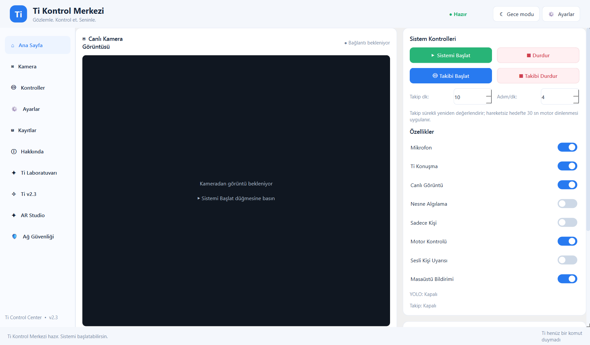
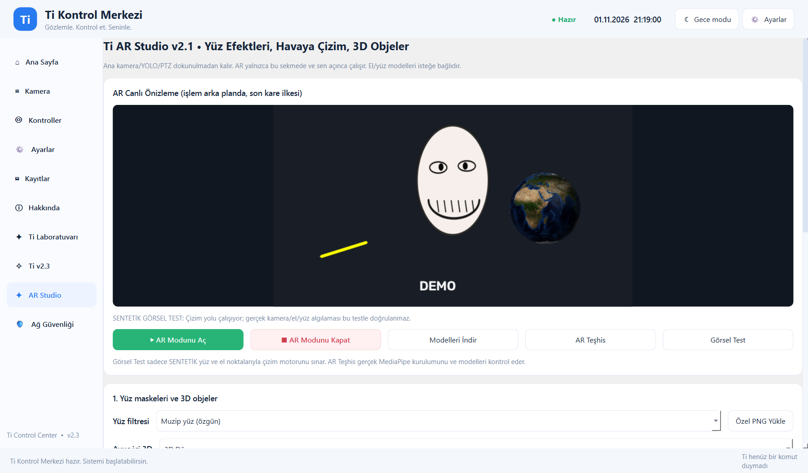
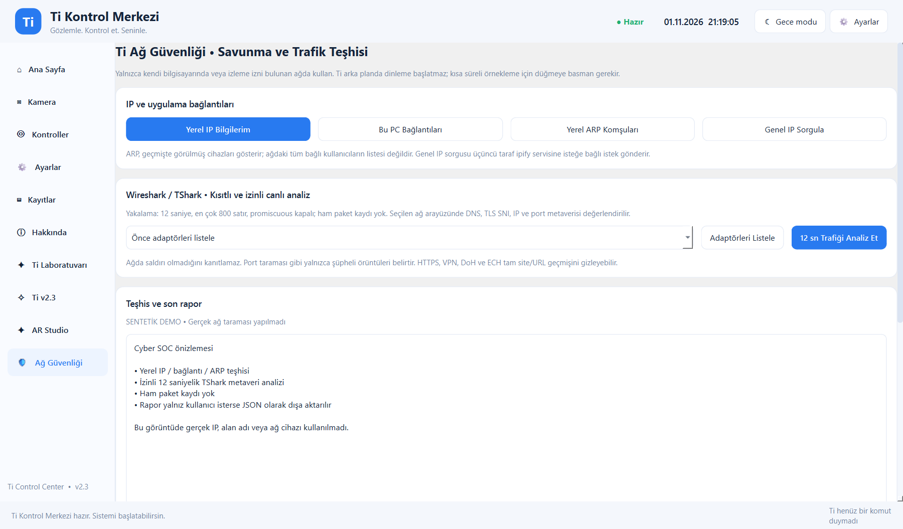

# Ti AI v2.3 — çalıştırılabilir demo paketi

Bu klasör, C301 projesinde geliştirilen güncel **Ti AI Kontrol Merkezi** kaynaklarını
kişisel veri, kamera kimlik bilgisi ve yerel ağ geçmişi olmadan içerir. Bu bir
geliştirme demosudur; bitmiş güvenlik ürünü değildir.



## Ekran görüntüleri

| AR Studio | Ağ Güvenliği / Cyber SOC |
|---|---|
|  |  |

AR karesi uygulamanın **Görsel Test** düğmesinin ürettiği sentetik çizim testi;
Cyber SOC karesi ise gerçek IP, MAC veya alan adı içermeyen güvenli arayüz
önizlemesidir.

## Neler var?

- PySide6 masaüstü kontrol merkezi ve karanlık/açık tema.
- Yerel C301/go2rtc akışı, en güncel kare yaklaşımı ve YOLO nesne/kişi algılama.
- Faster-Whisper Türkçe komut algılama ve deneysel C301 hoparlör geri kanalı.
- Opt-in kişi takibi, fotoğraf/video, yerel olay geçmişi ve sistem tanısı.
- AR Studio: el/yüz landmark modelleri, çizim, maskeler ve NASA Blue Marble dokulu dünya.
- Yerel ağ gözlem raporu ve elle içe aktarılan modem cihaz envanteri karşılaştırması.
- İsteğe bağlı Ollama/OpenAI sohbeti, Telegram, Home Assistant, Spotify ve yerel mobil panel.

Yüz kimliği tanımaz, insanları teşhis etmez ve fiziksel mesafe/radar ölçümü yapmaz.
Motor/PTZ ve iki yönlü ses deneysel olup her C301 yazılımında çalışacağı garanti edilmez.

## Hızlı kurulum (Windows 10/11)

1. Python **3.11 x64**, FFmpeg ve kendi C301 kullanımınız için go2rtc kurun.
2. Bu klasörde `Kurulum.cmd` dosyasını çalıştırın. Kurulum, yalnızca bu klasörde
   `.venv` oluşturur ve `requirements.txt` paketlerini kurar.
3. `Ti_Baslat.cmd` ile uygulamayı açın.

Komut satırıyla aynı işlem:

```powershell
py -3.11 -m venv .venv
.\.venv\Scripts\python.exe -m pip install --upgrade pip
.\.venv\Scripts\python.exe -m pip install -r requirements.txt
.\.venv\Scripts\python.exe Ti_Kontrol_Merkezi_v1.py
```

Yalnız arayüzü ve donanımsız demoyu denemek isteyenler daha küçük bağımlılık
setini kurabilir:

```powershell
.\.venv\Scripts\python.exe -m pip install -r requirements-core.txt
.\.venv\Scripts\python.exe Ti_Kontrol_Merkezi_v1.py --smoke-test
```

## C301 bağlantısı

Gerçek `go2rtc.yaml` dosyanızı **bu depoya kopyalamayın**. Varsayılan güvenli yol:

```text
%LOCALAPPDATA%\C301-go2rtc\go2rtc.yaml
```

Başka bir yerdeyse yalnız kendi bilgisayarınızda ortam değişkeni kullanın:

```powershell
$env:TI_GO2RTC_CONFIG = 'C:\camera-local\go2rtc\go2rtc.yaml'
.\Ti_Baslat.cmd
```

Uygulama yalnız `rtsp://127.0.0.1:8554/` altındaki yerel akışları kabul eder.
Önerilen akış adı `c301`'dir. Xiaomi hesabı/tokenı, gerçek YAML, IP/MAC listeleri
ve kamera kayıtları GitHub'a konmaz.

## Modeller ve isteğe bağlı hizmetler

- YOLO ağırlığı ilk gerçek algılamada Ultralytics tarafından indirilebilir.
- MediaPipe `.task` dosyaları repoda yoktur; AR Studio içindeki **Modelleri İndir**
  düğmesi yalnız Google'ın resmi MediaPipe adreslerinden indirir.
- OpenAI, Telegram, Home Assistant ve Spotify özellikleri anahtarsız kapalı kalır.
  Örnek adlar `.env.example` içindedir; uygulama `.env` dosyasını otomatik yüklemez.
- gTTS kullanıldığında söylenecek metin Google TTS hizmetine gönderilir.

## Testler

Kamera, hesap veya gerçek model ağırlığı gerektirmeyen testler:

```powershell
$modules = Get-ChildItem Ti_*Testleri.py | ForEach-Object BaseName
.\.venv\Scripts\python.exe -m unittest -v $modules Ti_Buton_Gorsel_Test
```

Arayüz duman testi:

```powershell
$env:QT_QPA_PLATFORM = 'offscreen'
.\.venv\Scripts\python.exe Ti_Kontrol_Merkezi_v1.py --smoke-test
```

## Yerel olarak oluşan özel veriler

`Ti_Veriler/`, `Ti_Kayitlar/`, `Ti_AR_Modeller/`, `_voice_test/`, SQLite/JSON/CSV
çıktıları, kamera fotoğraf/video/ses kayıtları ve model ağırlıkları `.gitignore`
ile dışlanmıştır. Paylaşmadan önce yine de `git status` ve gizlilik taraması yapın.

NASA Blue Marble dokusu: [NASA Earth Observatory](https://science.nasa.gov/earth/earth-observatory/the-blue-marble-true-color-global-imagery-at-1km-resolution/).
